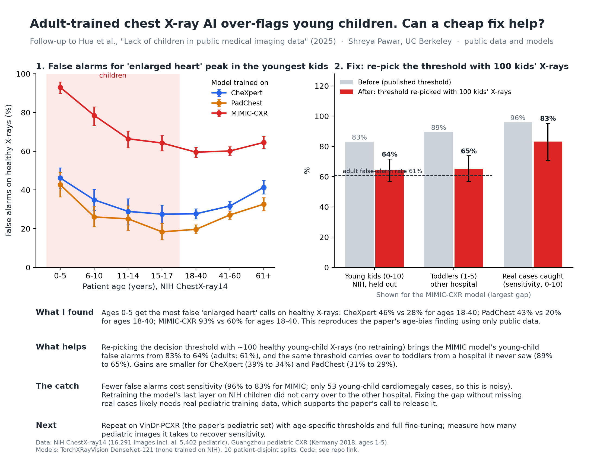

# How much pediatric data does it take to fix age bias in chest X-ray AI?

Follow-up to Hua et al., *Lack of children in public medical imaging data points to growing age bias in
biomedical AI* (medRxiv 10.1101/2025.06.06.25328913; Nature Health 2026). That paper shows adult-trained chest
X-ray models have higher cardiomegaly false-positive rates in younger children. This project asks the next
question: **what is the cheapest fix, and how many pediatric images does it need?**

All data and models are public, so anyone can rerun it.

## Setup

| Piece | What |
|---|---|
| Models | Three adult-trained DenseNet-121 models from TorchXRayVision: CheXpert, PadChest, MIMIC-CXR. None was trained on NIH, the evaluation set. |
| Main evaluation data | NIH ChestX-ray14 (via `timm/nih-chest-xray-14`): every image of a patient under 18, every adult cardiomegaly image, and a seeded 8% sample of other adults |
| External pediatric data | Guangzhou pediatric chest X-rays (Kermany et al. 2018, ages 1–5, CC BY 4.0, via `hf-vision/chest-xray-pneumonia`) |
| Negatives | Images with no finding ("healthy"), matching the paper's false-positive definition |

## Experiments

1. **Replication.** False-positive rate at each model's published operating point, by age bin.
2. **Fixes (ages 0–10, where the bias is).** Young pediatric patients are split 50/50 into a calibration pool and a test set (no patient appears in both), repeated over 10 random splits. For n = 0, 25, 50, 100, 250 and all (~1,100) young-child calibration images:
   - **A. Published threshold** (baseline).
   - **B. Pediatric threshold.** Re-pick the decision threshold so the false-positive rate on n pediatric images matches the adult rate. No retraining.
   - **C. Retrained head.** Logistic regression on frozen DenseNet features (128 PCA components), trained on adults plus the same n pediatric images. The threshold is set on adults only.
3. **Undocumented ages.** A linear probe that flags pediatric images, for datasets that don't report age. It is checked on held-out NIH patients and on the external Guangzhou set.

## Run

```bash
python3 -m venv .venv && .venv/bin/pip install torch torchvision torchxrayvision scikit-image pandas matplotlib scikit-learn huggingface_hub pyarrow tabulate
# pediatric parquet files from hf-vision/chest-xray-pneumonia go in data/peds_*.parquet
.venv/bin/python -I src/prepare_peds.py
.venv/bin/python -I src/prepare_nih.py 0 42      # streams ~22 GB, keeps ~17k images
.venv/bin/python -I src/infer.py
.venv/bin/python -I src/analyze.py               # writes results/summary.md and figures
.venv/bin/python -I src/one_pager.py             # one-page PDF/PNG summary
```

## Results



- **The bias reproduces with public data.** On healthy X-rays, ages 0–5 get the most false cardiomegaly calls: CheXpert 46% vs 28% for ages 18–40, PadChest 43% vs 20%, MIMIC-CXR 93% vs 60%. Pooled over all children the gap mostly disappears, because NIH's children are mostly teenagers. The bias is concentrated in ages 0–10.
- **A cheap fix helps.** Re-picking the threshold with about 100 healthy young-child X-rays (no retraining) cuts young-child false alarms for the MIMIC model from 83% to 64% (adults: 61%). The same threshold carries over to toddlers from an unseen hospital (Guangzhou, 89% to 65%). Gains are smaller for CheXpert (39% to 34%) and PadChest (31% to 29%). With only 25 images, the results vary a lot from split to split.
- **The catch.** Lower false alarms cost sensitivity (MIMIC 96% to 83%; only 53 young-child positives, so this is noisy). Retraining the last layer on NIH children lowered NIH false alarms but didn't carry over to the other hospital. Closing the gap without missing real cases likely needs pediatric training data.
- **Undocumented ages.** A linear probe flags NIH children well (AUROC 0.95; 100% of ages 0–5 flagged) but only 40% of Guangzhou toddlers. It doesn't carry over across hospitals.

Full tables: `results/summary.md`. Figures: `results/fig1_fpr_by_age.png`, `results/fig2_fixes.png`. One-pager: `results/one_pager.pdf`.

## Limitations

- NIH labels were mined from radiology reports with NLP, so they're noisy. Pediatric cardiomegaly positives are few, so sensitivity estimates have wide error bars.
- The head retraining (C) is a linear probe on frozen features, not full fine-tuning.
- The Guangzhou set has no cardiomegaly labels, so it only measures false positives.
- The paper's own pediatric test set (VinDr-PCXR) needs credentialed PhysioNet access and wasn't used here.

## Data, privacy and licenses

No images or patient-level records are in this repository. Only code and summary results (rates per age group, averaged over splits) are published. Running the code downloads the data from its original public sources.

| Source | Terms | Use here |
|---|---|---|
| NIH ChestX-ray14 ([download site](https://nihcc.app.box.com/v/ChestXray-NIHCC)) | De-identified. NIH: "The usage of the data set is unrestricted," with a link, acknowledgment and citation required | Evaluation only. We acknowledge the **NIH Clinical Center** as the data provider. |
| Guangzhou pediatric chest X-rays ([Mendeley Data](https://data.mendeley.com/datasets/rscbjbr9sj/2)) | CC BY 4.0 | Evaluation only (external pediatric test set) |
| TorchXRayVision ([GitHub](https://github.com/mlmed/torchxrayvision)) | Apache 2.0 | Pretrained models used as-is. No weights redistributed. |

## Citations

- Hua S, et al. *Lack of children in public medical imaging data points to growing age bias in biomedical AI.* medRxiv 2025. doi:10.1101/2025.06.06.25328913
- Wang X, Peng Y, Lu L, Lu Z, Bagheri M, Summers RM. *ChestX-ray8: Hospital-scale chest X-ray database and benchmarks on weakly-supervised classification and localization of common thorax diseases.* CVPR 2017.
- Kermany D, Zhang K, Goldbaum M. *Labeled Optical Coherence Tomography (OCT) and Chest X-Ray Images for Classification.* Mendeley Data, V2, 2018. doi:10.17632/rscbjbr9sj.2
- Cohen JP, Viviano JD, Bertin P, et al. *TorchXRayVision: A library of chest X-ray datasets and models.* MIDL 2022.

## Author

Shreya Pawar, UC Berkeley (EECS + Business, M.E.T.)
